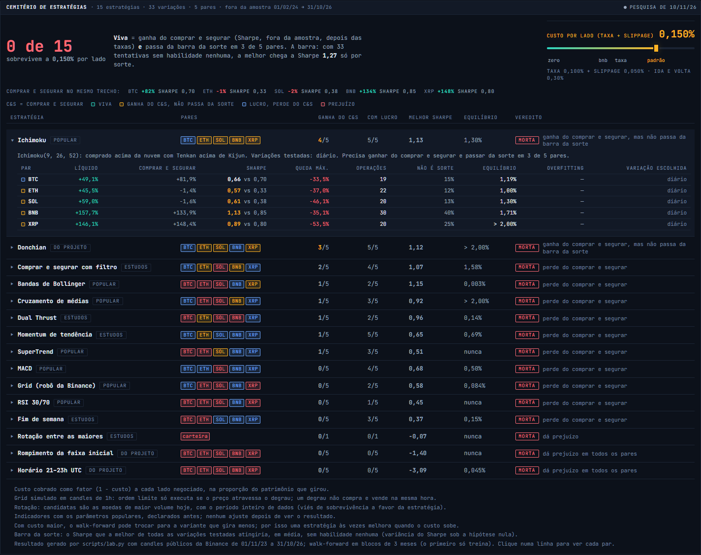
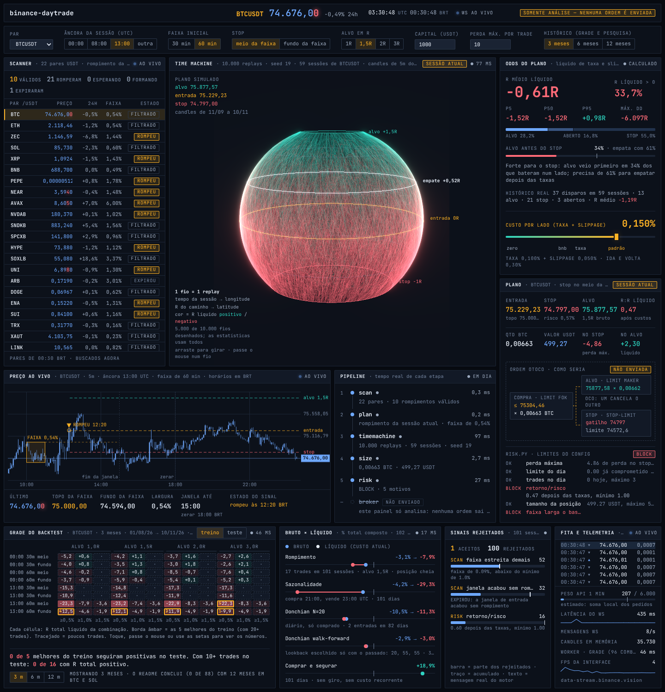
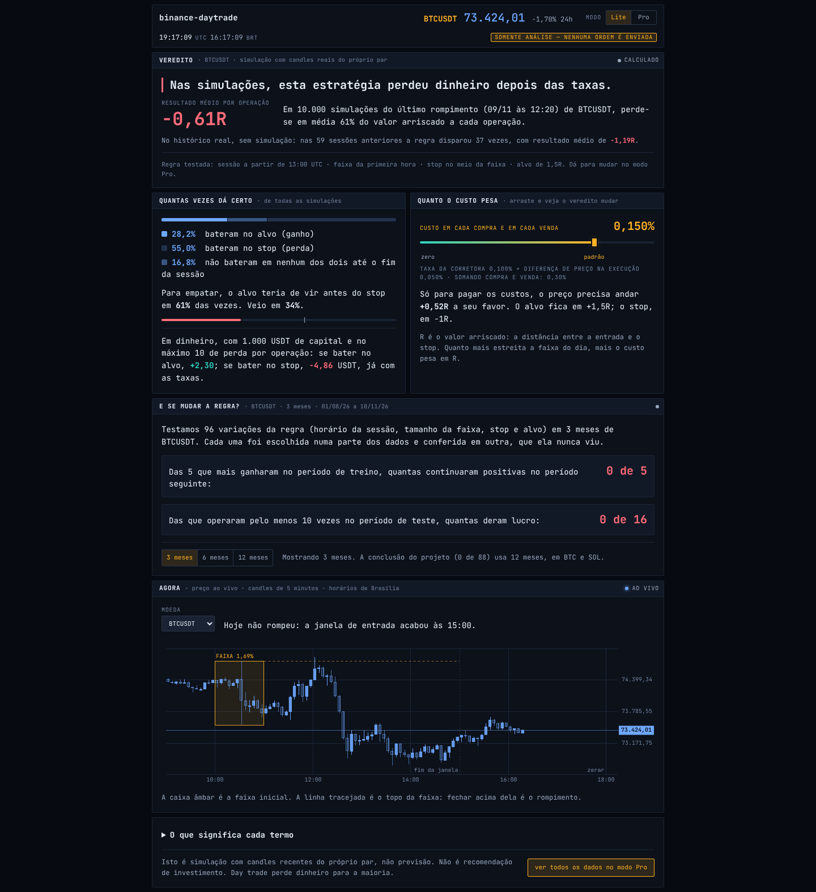
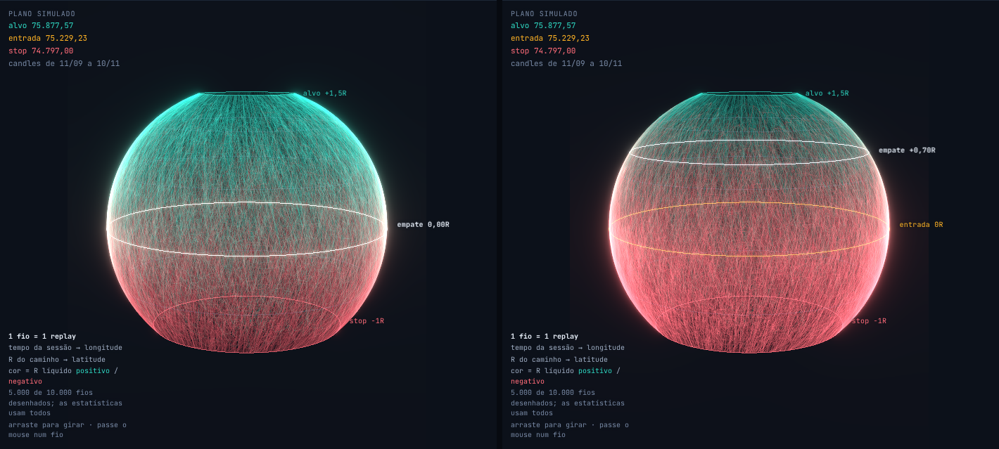

# binance-daytrade

[](https://github.com/JvFaraco/binance-daytrade/actions/workflows/web.yml)

**Painel ao vivo: [jvfaraco.github.io/binance-daytrade](https://jvfaraco.github.io/binance-daytrade/)**

- [Modo Lite](https://jvfaraco.github.io/binance-daytrade/?modo=lite): o veredito numa tela só, para quem nunca operou.
- [Modo Pro](https://jvfaraco.github.io/binance-daytrade/?modo=pro): scanner, esfera com os 10.000 replays, backtest treino × teste e o plano.

Somente análise: dados públicos da Binance, sem chave e sem enviar ordem. Roda no navegador, sem instalar nada.

Day trade spot na Binance feito em skill do Claude: scanner de rompimento, plano,
simulação das odds, backtest com treino e teste, tamanho da posição, checagem de
risco e envio da ordem só depois do seu sim. Testnet por padrão. Python 3.8+, só
biblioteca padrão.

Inspirado na estrutura do `day-trader-skill` do Jake Schincariol (ações, Yahoo/Alpaca),
mas escrito do zero para a Binance. Nenhum código foi copiado.

## Instalar

```powershell
# Windows (PowerShell): baixa o repositório e aponta $S pros scripts
git clone https://github.com/JvFaraco/binance-daytrade.git
$S = "$PWD\binance-daytrade\scripts"
```

```bash
# como skill do Claude Code
git clone https://github.com/JvFaraco/binance-daytrade.git ~/.claude/skills/binance-daytrade
```

Na pasta do projeto: `cp config.example.json trader/config.json` e ajuste capital, perda
máxima por trade, âncora de horário etc.

## Testnet

Crie chaves em https://testnet.binance.vision e exporte:

```powershell
$env:BINANCE_TESTNET_API_KEY = "..."
$env:BINANCE_TESTNET_API_SECRET = "..."
python $S\broker.py check        # só leitura: chave, relógio, saldo, comissão real
```

Dinheiro real só com `"paper": false` no config **e** `BN_LIVE=1` no ambiente.

## Fluxo

```
scan.py orb  ->  plan.py plan  ->  timemachine.py run  ->  size.py  ->  risk.py  ->  broker.py
history.py fetch + backtest.py run      (antes de confiar na regra)
```

A ordem vai como **OTOCO**: compra LIMIT FOK (tudo ou nada) e, se executar, alvo e stop
nascem juntos na Binance como par OCO. Não existe janela em que a posição fica sem stop.
`entry_mode: "two-step"` no config volta ao modo antigo (IOC, depois OCO).

## Resultado da pesquisa (BTC e SOL, 12 meses)

Rompimento de faixa inicial: **nenhuma vantagem depois das taxas** (0 de 88 combinações
positivas fora da amostra). O `research.py` testa o que a literatura indica como viável em
cripto, com custo e walk-forward:

```powershell
python $S\research.py all BTCUSDT,SOLUSDT,ETHUSDT --months 12
```

Referências: Padysak & Vojtko (2022) sobre seasonality/trend em BTC horário; Concretum (2025)
sobre Donchian em cripto líquido de taxas; arXiv 2606.00060 (2026) sobre walk-forward em BTC
horário, onde só sobrevive quem opera pouco e só com sinal maior que o custo.

## Cemitério de estratégias (5 pares, 36 meses)

O `lab.py` põe as estratégias mais usadas por cursos, corretoras e no TradingView, o **robô Grid da
própria Binance** e as que os estudos apontam como as melhores candidatas, todas na **mesma régua**,
junto com as regras deste projeto:

- custo por lado de 0 a 0,20% (o resultado sai para cada passo de 0,005%);
- BTC, ETH, SOL, BNB e XRP, de nov/2023 a out/2026; walk-forward em blocos de 3 meses, e só o
  trecho **fora da amostra** conta (fev/2024 → out/2026, 1.004 dias);
- comparação com comprar e segurar e com DCA semanal no mesmo trecho;
- parâmetros populares declarados antes de rodar, e **todas as 33 variações contam** no detector de sorte.

**Viva** = ganha do comprar e segurar (Sharpe líquido) **e** passa da barra da sorte (Sharpe
deflacionado ≥ 95%) em pelo menos 3 dos 5 pares. A barra: com 33 tentativas sem habilidade nenhuma,
a melhor chega a Sharpe anual ~1,27 só por sorte.

**Resultado: 0 de 15 sobrevivem, em nenhum custo, nem com taxa zero.**

| Estratégia | Ganha do comprar e segurar (sem taxa → 0,15%) | Com lucro (0,15%) | Melhor Sharpe (0,15%) | Custo de equilíbrio (mediana) |
| --- | --- | --- | --- | --- |
| Ichimoku | 5 → 4 de 5 | 5 de 5 | 1,13 | 1,30% |
| Donchian | 4 → 3 de 5 | 5 de 5 | 1,12 | > 2% |
| Comprar e segurar com filtro | 2 → 2 de 5 | 4 de 5 | 1,07 | 1,58% |
| Cruzamento de médias | 2 → 1 de 5 | 3 de 5 | 0,92 | > 2% |
| Bandas de Bollinger | 1 → 1 de 5 | 2 de 5 | 1,15 | 0,003% |
| SuperTrend | 0 → 1 de 5 | 3 de 5 | 0,51 | nunca |
| Momentum de tendência | 2 → 1 de 5 | 5 de 5 | 0,65 | 0,69% |
| Dual Thrust | 5 → 1 de 5 | 2 de 5 | 0,96 | 0,14% |
| RSI 30/70 | 0 → 0 de 5 | 1 de 5 | 0,45 | nunca |
| MACD | 1 → 0 de 5 | 4 de 5 | 0,68 | 0,50% |
| Grid (robô da Binance) | 1 → 0 de 5 | 2 de 5 | 0,58 | 0,08% |
| Fim de semana | 2 → 0 de 5 | 3 de 5 | 0,37 | 0,15% |
| Rompimento da faixa inicial | 0 → 0 de 5 | 0 de 5 | −1,40 | nunca |
| Horário 21–23h UTC | 4 → 0 de 5 | 0 de 5 | −3,09 | 0,04% |
| Rotação entre as 20 maiores (carteira) | 0 → 0 | 0 | −0,07 | nunca |

Como ler:

- **Ichimoku e Donchian chegam mais perto.** Ganham do comprar e segurar em 4 e 3 dos 5 pares, mas o
  Sharpe deles (1,13 e 1,12) não passa do que a sorte daria com 33 tentativas.
- **Dual Thrust e Horário 21–23h morrem pela taxa.** Sem custo, ganham do comprar e segurar em 5 e 4
  pares; o lucro zera com 0,14% e 0,04% por lado.
- **O Grid e o RSI perdem do comprar e segurar mesmo de graça** em quase todos os pares.
- **Comprar e segurar foi muito forte no período:** BTC +82%, BNB +134%, XRP +148%. ETH e SOL ficaram
  perto de zero, com quedas de 68% e 76% no caminho.
- O custo de equilíbrio é a taxa por lado em que o lucro fora da amostra zera; "nunca" = não dá
  lucro nem de graça.

```powershell
python $S\lab.py fetch      # 43 meses de 5m dos 5 pares (~85 MB em trader/) e o diário do universo da rotação
python $S\lab.py run        # grava web/public/cemiterio.json, que o painel lê
python $S\lab.py show       # o resumo no console
```

No painel, a aba **Cemitério de estratégias** (modo Pro) mostra tudo isso para o custo do controle, com
a tabela por par de cada estratégia; o modo Lite mostra só a contagem.



Limites: um período só (e de alta para BTC, BNB e XRP); a rotação usa as moedas de maior volume
hoje (viés de sobrevivência **a favor** dela); o Grid é simulado em candles de 1h, com ordem limite
executando só se o preço atravessa o degrau; com custo maior, o walk-forward pode trocar para a
variante que gira menos, e por isso uma estratégia às vezes melhora quando o custo sobe.

## Painel web

**Abrir:** [jvfaraco.github.io/binance-daytrade](https://jvfaraco.github.io/binance-daytrade/)
([Lite](https://jvfaraco.github.io/binance-daytrade/?modo=lite) · [Pro](https://jvfaraco.github.io/binance-daytrade/?modo=pro))

`web/` é um painel de **análise** (não envia ordem, não pede chave) que mostra a conclusão acima
com dados públicos e ao vivo da Binance: scanner, preço com a faixa inicial, os 10.000 replays do
Time Machine numa esfera, a grade do backtest em treino × teste e o bruto × líquido das estratégias.
O motor foi portado para TypeScript com testes de paridade contra os scripts Python.



### Modo Lite

Quem nunca operou abre no **modo Lite**: a mesma conclusão numa tela só, com o mínimo de dados. O botão
**Lite | Pro** na barra alterna os dois sem recarregar, e os números são os mesmos. Dá para mandar o
link já no modo certo com `?modo=lite` ou `?modo=pro`.



Arrastar o custo de 0 a 0,2% por lado recolore a esfera sem refazer os sorteios:



```bash
cd web && npm ci && npm run dev
```

Detalhes, o que foi verificado e limites em [`web/README.md`](web/README.md). O workflow
`.github/workflows/web.yml` testa e publica no GitHub Pages a cada push na `main` que mexa em
`web/`, `scripts/` ou `tests/`.

## Testes

```bash
python3 -m unittest discover -s tests -v
```

92 testes, offline, com candles sintéticos e uma corretora falsa. Cobrem o sinal, o
dimensionamento e os filtros, os limites de risco, a simulação (inclusive o modo em blocos), o
backtest, a leitura dos zips mensais (com timestamps em microssegundos), a assinatura HMAC (contra o
exemplo da documentação da Binance) e os fluxos OTOCO e two-step do broker, e as travas de segurança:
todo registro do dia conta no limite, `--now` só na testnet, ordem conferida contra o plano,
`status`/`flatten` no mesmo modo do config e `flatten` cancelando só as listas que o broker criou.
O laboratório tem um teste por regra (cada estratégia faz o que diz num caso sintético) e pela régua:
modelo de custo, walk-forward só com o passado, Sharpe deflacionado, PBO e custo de equilíbrio contra a
fórmula fechada.

## O que foi conferido na documentação oficial

Fonte: `binance/binance-spot-api-docs` (rest-api.md, filters.md, faqs) e a página da
testnet. Em particular:

- `POST /api/v3/orderList/otoco`: `workingType=LIMIT`, `workingTimeInForce=FOK`,
  `pendingAboveType=LIMIT_MAKER`, `pendingBelowType=STOP_LOSS_LIMIT` + `pendingBelowTimeInForce`.
- `POST /api/v3/orderList/oco`: `aboveType/abovePrice`, `belowType/belowStopPrice/belowPrice/belowTimeInForce`.
  Restrição de preço na venda: alvo > último preço > stop.
- `DELETE /api/v3/orderList` cancela só a lista (em vez de todas as ordens do par).
- Timestamp mais de 1 s à frente do servidor é rejeitado: o broker sincroniza com `/api/v3/time`.
- Limites por IP: `X-MBX-USED-WEIGHT-1M` (6000/min), 429 com `Retry-After`, 418 = banimento.
  `ticker/24hr` sem símbolo pesa 80; por isso a lista de pares fica em cache.
- Filtros: `PRICE_FILTER`, `LOT_SIZE`, `MARKET_LOT_SIZE`, `NOTIONAL` (mín e máx),
  `PERCENT_PRICE_BY_SIDE`, e a regra de faixa de execução (`executionRules` + `referencePrice`).
- Comissão real: `GET /api/v3/account/commission` (e desconto em BNB). `broker.py check` compara com o config.
- Arquivos mensais em `data.binance.vision` (klines 5m) com timestamp em microssegundos desde 2025.

## O que já rodou contra a Binance (testnet, 2026-11-02)

- `scan.py universe/orb`, `plan.py`, `timemachine.py` (60 dias), `size.py` (exchangeInfo + avgPrice)
  e `risk.py`, com dados reais de mercado.
- `broker.py check` (conta, relógio, comissão), `send entry` em modo OTOCO (compra FOK executada,
  alvo LIMIT_MAKER e stop STOP_LOSS_LIMIT criados juntos), `status` e `flatten`
  (DELETE /api/v3/orderList + venda a mercado). Lista encerrada como ALL_DONE.

## O que ainda NÃO foi verificado

- Alvo ou stop executando sozinhos (depende de o preço chegar lá; é a Binance quem executa).
- O modo `two-step` (IOC + OCO) contra a API real; só na corretora falsa dos testes.
- `history.py fetch` e `backtest.py` com os zips reais de data.binance.vision.
- Conta real. A testnet não cobra taxa e tem liquidez artificial; preços podem diferir dos reais.
- A testnet é apagada periodicamente; `state.json` pode apontar para listas que não existem mais.

## Limites honestos

- O Time Machine sorteia candles de 5m como se fossem independentes: perde a sequência de
  volatilidade e as caudas gordas de cripto. O modo em blocos (bootstrap estacionário, trechos
  seguidos de sessões reais) roda junto e corrige parte disso, mas os dois são checagem de
  sanidade, não previsão.
- O backtest separa treino e teste, mas um par e um ano não provam nada. Repita em outros
  pares e períodos antes de acreditar numa combinação.
- Taxas pesam. Com 0,1% por lado mais slippage, uma faixa de 1% gasta boa parte do risco só
  em custo. O R médio líquido mostra isso; alvo de 1R não passa no retorno/risco.
- O limite diário soma o risco máximo das ordens enviadas, não o resultado realizado.
- Stop-limit não garante saída num gap. A perda máxima mostrada é no preço do stop.

Não é recomendação de investimento. Day trade perde dinheiro para a maioria.

## Licença

[MIT](LICENSE). Pode usar, copiar e modificar, mantendo o aviso de copyright. Sem garantia de nenhum tipo.
