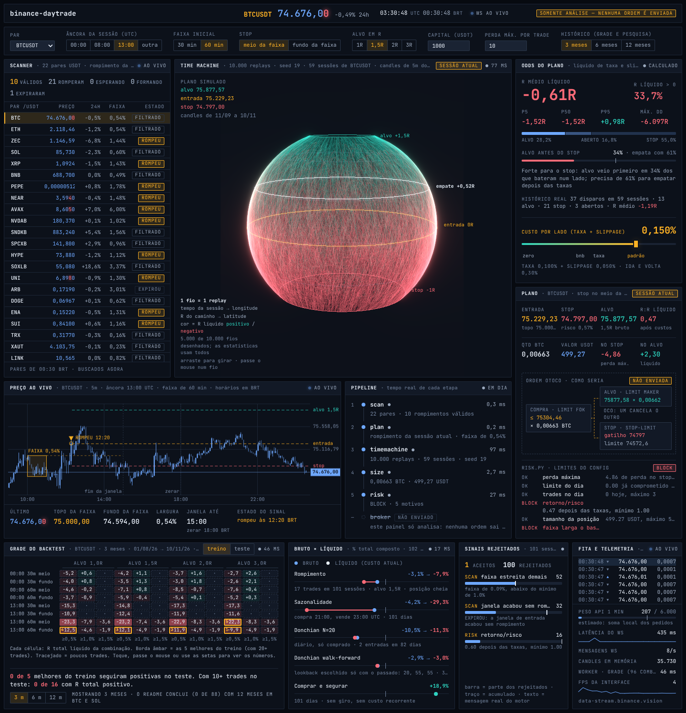
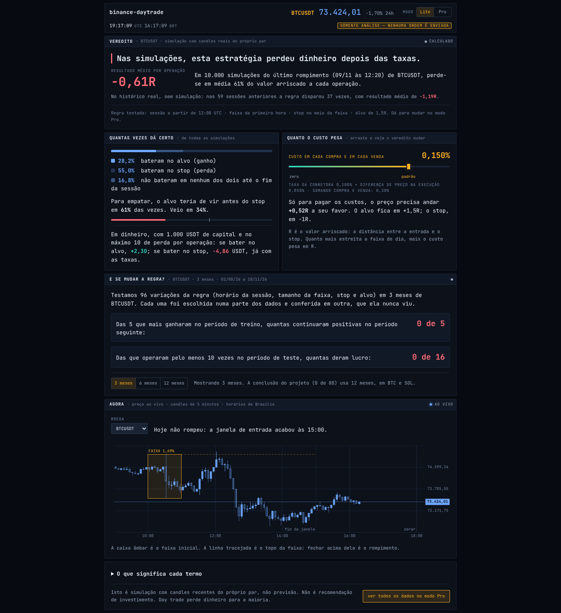
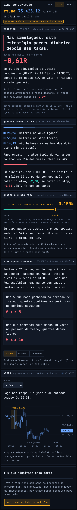
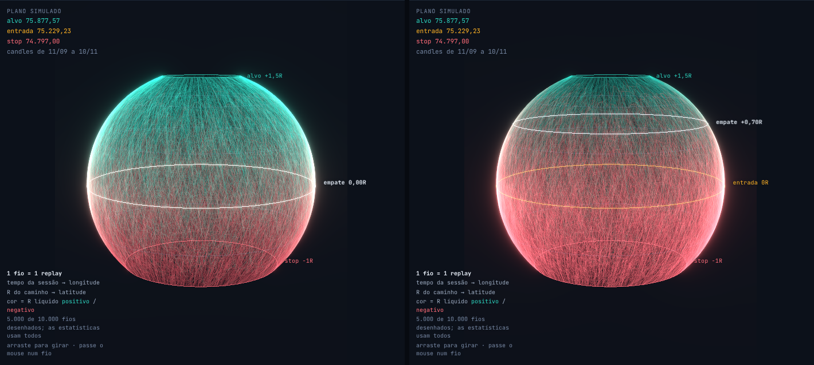
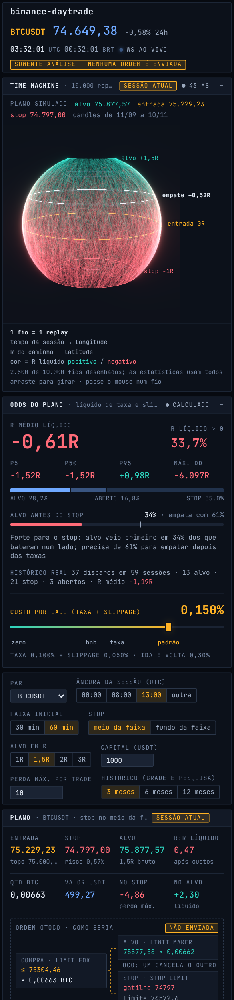
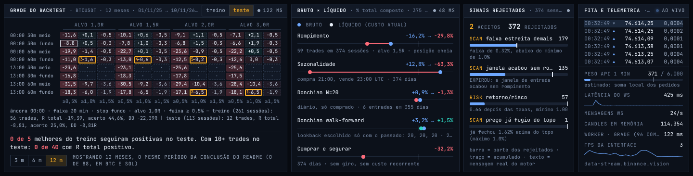

# Painel web de análise

Painel escuro e denso que mostra, com dados públicos e ao vivo da Binance, a conclusão do
projeto: **rompimento da faixa inicial não tem vantagem depois das taxas**.

**No ar:** [jvfaraco.github.io/binance-daytrade](https://jvfaraco.github.io/binance-daytrade/)
([Lite](https://jvfaraco.github.io/binance-daytrade/?modo=lite) · [Pro](https://jvfaraco.github.io/binance-daytrade/?modo=pro)).

**Somente análise.** Nenhuma ordem é enviada, nenhuma chave de API é pedida ou guardada, nenhum
endpoint assinado é chamado. O `broker.py` não foi portado.



## Rodar

```bash
cd web
npm ci
npm run dev        # http://localhost:5173/binance-daytrade/
```

```bash
npm run lint && npm run typecheck && npm test && npm run build
```

`npm test` precisa de `python3`: antes dos testes, `tools/export_parity.py` roda o motor Python
do repositório e exporta os candles sintéticos e as saídas que o TypeScript tem que reproduzir.

## O que cada número é

Todo número na tela sai de cálculo real sobre dado real. Carregando, vazio, erro e "a API limitou"
são estados desenhados; não há valor de enfeite.

| Painel | De onde vem |
| --- | --- |
| Scanner | `ticker/24hr` (MINI, cache de 30 min) + candles de 5m; `orb_signal`, `filter_hits` e `explain_filtered` do `scan.py` |
| Preço ao vivo | candles de 5m (REST + WebSocket `kline_5m`), faixa inicial e candle de rompimento do sinal |
| Pipeline | tempo medido de cada etapa: scan → plan → timemachine → size → risk. O broker aparece apagado: "não enviado" |
| Esfera (Time Machine) | 10.000 replays com seed 19 e janela ±2, como `timemachine.py`; 60 dias de candles do par |
| Odds do plano | R médio líquido, % de replays com R líquido > 0, p5/p50/p95, drawdown, veredito do `timemachine.py` |
| Plano | `plan.py` + `size.py` (com `exchangeInfo` e `avgPrice` reais) + `risk.py`; diagrama OTOCO **não enviada** |
| Grade do backtest | as 96 combinações do `backtest.py`, treino 70% / teste 30%, em 3, 6 ou 12 meses |
| Bruto × líquido | rompimento, sazonalidade 21–23 UTC, Donchian diário (fixo e walk-forward) e comprar e segurar |
| Sinais rejeitados | por que cada sessão do período não virou trade, com a mensagem que o motor devolve |
| Fita e telemetria | `aggTrade` ao vivo; peso de API, latência do WS, candles em memória, tempo do worker, fps |

Quando o par escolhido não rompeu na sessão atual, o plano vem do **último rompimento do histórico**
e fica marcado como "replay de dd/mm". O `testplan` do skill não é usado: ele não é um setup.

## Modo Lite

O botão **Lite | Pro** na barra superior alterna entre o painel completo (Pro) e uma versão de uma tela
só para quem nunca operou. O Lite não mostra outra coisa: mostra a mesma conclusão com o mínimo de dados.



| Bloco do Lite | O que mostra (os mesmos números do Pro) |
| --- | --- |
| Veredito | uma frase, o R médio líquido dos 10.000 replays e a barra de ganhou / nem um nem outro / perdeu |
| Taxa | o mesmo controle de custo do Pro; arrastar muda o veredito na hora |
| E mudando a regra? | de quantas das 96 variações com 10+ operações no teste deram lucro |

Todo o resto fica só no Pro: scanner, pipeline, esfera, percentis, drawdown, plano, OTOCO, checagens de
risco, mapa da grade, halteres, Pareto, fita, telemetria, gráfico de preço e os controles da regra e do
período. O Lite usa a regra e o período que estiverem configurados e diz qual é o período.

Garantias, todas cobertas por teste:

- **Mesmos números.** Os dois modos leem as mesmas stores e as mesmas funções derivadas, com a mesma
  formatação. `tests/lite.dom.test.tsx` renderiza os dois com o mesmo estado, compara os 6 números do
  Lite com os do Pro em cinco custos diferentes e confere cada um contra o motor calculado à parte.
- **Veredito sem maquiagem.** Resultado negativo abre o bloco dizendo que perdeu dinheiro. Resultado
  positivo nunca fica verde nem vira promessa: o título diz que isso sozinho não prova nada.
- **O que o Lite não mostra não pesa.** Os painéis do Pro e o three.js ficam em pedaços carregados sob
  demanda. No Lite o worker não monta os buffers da esfera, não roda a pesquisa nem o Pareto, e só o par
  escolhido é acompanhado ao vivo (1 pedido de candles em vez de um por par). Abrir o Pro carrega o resto
  sem recarregar a página; os replays são refeitos com a mesma seed só para gravar os caminhos da esfera.
- **Modo na URL e salvo.** `?modo=lite` ou `?modo=pro` vence o valor salvo, que vence o padrão (Lite na
  primeira visita). Modo, par, custo e período ficam no `localStorage` do navegador; nada mais é guardado.



Frases em que foi preciso escolher entre simples e exato:

- "Perdeu dinheiro depois das taxas" é o resultado da simulação de um plano num par, não uma lei; o
  subtítulo diz que são 10.000 simulações e o rodapé diz que é simulação, não previsão.
- "Em média, perde 61% do valor arriscado" é o mesmo −0,61R, mostrado ao lado. "Valor arriscado" é a
  distância entre a entrada e o stop; a perda real num stop é maior (1R mais os custos).
- "Ganhou / perdeu / nem um nem outro" são alvo primeiro, stop primeiro e aberto até zerar. As porcentagens
  ficam com a mesma casa decimal do Pro (28,2%), não viram "28 de cada 100".
- "Taxa em cada compra e em cada venda" inclui o slippage; o Pro separa os dois.
- "Deram lucro em dados que não tinham visto" é R total positivo no período de teste, entre as variações
  com pelo menos 10 operações nele.

## A esfera e o controle de custo



Cada fio é um replay: o tempo da sessão vira longitude, o R do caminho vira latitude (equador =
entrada, norte = ganho, sul = perda) e a cor é o R **líquido** final. Arrastar o custo de 0 a 0,2%
por lado recolore tudo e move a linha de empate sem refazer nenhum sorteio: no `run_mc` o custo só
entra no `net_r`, então o shader recalcula o líquido de cada fio a partir do R bruto de saída. O mesmo
vale para a grade e a pesquisa: os trades não dependem de custo, só o resultado líquido.

Passar o mouse num fio (ou usar ← → com a esfera em foco) mostra o R bruto e o líquido daquele replay.

## Paridade com o Python

O motor foi portado para `src/engine/` e os testes exigem o mesmo resultado do Python
(`tests/parity.test.ts`, 75 casos): sinal, custos, scanner, plano, Time Machine, grade, pesquisa,
tamanho e risco. A comparação é por igualdade exata dos números, com três peças portadas para isso:

- `PyRandom`: o Mersenne Twister do CPython, com a mesma semeadura e o mesmo `choice()`.
- `Dec`: decimal em `BigInt` para `floor_step`/`ceil_step`.
- `pySum`, `pyRound`, `fmtG`: soma compensada, arredondamento metade-par e `%g` do Python.

Única tolerância (1e-12 relativo): erro-padrão e t do perfil por hora, onde o Python eleva ao
quadrado com `pow()` da libc. Com Python anterior ao 3.12 as somas longas também usam essa
tolerância, porque só a partir do 3.12 o `sum()` é compensado.

Conferência extra com candles reais (precisa de rede, fica fora do CI):

```bash
python3 tools/real_parity.py BTCUSDT 120 /tmp/real.json
```

```bash
REAL_FIXTURE=/tmp/real.json npx vitest run tests/real.test.ts
```

Diferenças conhecidas em relação ao Python:

- `plan_fingerprint` não existe no TS: ele só serve para o `broker.py` casar ordem e checagem de risco.
- O Python divide decimais com 28 dígitos antes de truncar; o TS usa divisão inteira exata. Só
  divergiriam com quocientes acima de ~1e20.
- O scanner pede 300 candles por par (25 h) em vez de pedir a partir do início da sessão; o sinal
  ignora o que vem antes da sessão, então o resultado é o mesmo e mudar a âncora não gasta pedidos.
- Meses de histórico vêm por klines paginados (cache em IndexedDB por par e mês), não dos zips mensais.

## Arquitetura

```
src/engine/     motor puro (sem DOM): porte de scripts/*.py
src/data/       REST público, WebSocket, IndexedDB, histórico paginado
src/workers/    Web Worker: pedidos, cache, 10.000 replays, grade e pesquisa
src/app/        controlador do pipeline, dados de alta frequência, formatação
src/state/      stores zustand por assunto (um tick do WS não re-renderiza a árvore)
src/ui/         Panel, Stat, Sparkline, Meter, Badge, Tooltip, LiveDot, Skeleton, número vivo
src/panels/     os painéis do Pro (e o que os dois modos compartilham: barra, custo, gráfico)
src/lite/       o modo Lite: tela e frases
src/ProBoard.tsx  o Pro inteiro, num pedaço carregado sob demanda
src/sphere/     geometria e cena three.js (carregada sob demanda)
src/styles/     tokens.css (design system), base e grade
```

Página aberta por horas: a lista de pares é renovada a cada 30 min (como o cache do `scan.py`), o
histórico do par é recarregado quando passa de 30 min de idade (só o mês corrente é pedido de novo) e,
depois de qualquer queda do WebSocket, os candles de todos os pares são buscados de novo antes de o
scanner voltar a rodar. Vinte segundos sem nenhuma mensagem contam como conexão morta.

Limite de pedidos: cada chamada declara o peso; a soma do último minuto aparece na telemetria
como "estimado" (o navegador não expõe `X-MBX-USED-WEIGHT-1M` por CORS). Em 429 o cliente espera
e tenta de novo no máximo duas vezes; em 418 para de pedir. A primeira carga gasta cerca de 240 de
6.000; 12 meses de um par, cerca de 200 a mais (uma vez; depois vem do cache).

## Design system

`src/styles/tokens.css`. Cores com função fixa: âmbar = sinal/seleção, verde-água = líquido
positivo, vermelho = líquido negativo e recusa do motor (erro, BLOCK), azul frio = dado bruto.
Uma mono (JetBrains Mono), seis tamanhos, espaço em múltiplos de 4, curvas de movimento definidas
uma vez, `prefers-reduced-motion` respeitado. Grade com áreas nomeadas: desktop denso, tablet em
duas colunas, celular com a esfera no topo e painéis recolhíveis.



## O que foi verificado

- Lint, tipos, 107 testes Vitest (paridade, peças do painel, fluxo ao vivo e modo Lite), 73 testes Python e build de produção.
- Modo Lite no Chromium contra a Binance real, em 1440 e 375 px: sem scroll horizontal, sem erro de console,
  nenhum pedido de three.js nem do pedaço do Pro; troca Lite → Pro → Lite sem recarregar, com os mesmos
  números, e `?modo=` vencendo o valor salvo. Lighthouse do Lite (2 execuções): 100 / 100 / 100, com
  118 KiB de JavaScript transferido.
- Paridade exata também com 120 dias de candles reais de BTCUSDT e SOLUSDT (replays, grade, pesquisa).
- App rodando no Chromium (Playwright) contra a Binance real: screenshots em 1440, 1024 e 390 px,
  sem scroll horizontal e sem erro de console; troca de par, de período (3 → 12 meses, e de novo
  pelo cache), de âncora, alvo e stop; controle de custo; hover e teclado na esfera.
- Estados de 418, 429 e queda de rede, simulados por interceptação dos pedidos.
- Virada real de um candle de 5m: o candle novo abre no horário, o que fechou entra no cálculo e o
  scanner roda de novo um segundo depois, sem buraco nos candles.
- Sessão com a faixa ainda em formação (âncora na hora cheia corrente): estado "formando" e plano em replay.
- WebSocket que para de entregar sem fechar e WebSocket fechado pelo servidor (fluxo real passando por
  um intermediário controlado): em ~20 s o painel deixa de dizer "ao vivo", reconecta e repõe os candles.
- Lighthouse desktop no build de produção (3 execuções): performance 99 a 100, acessibilidade 100, boas práticas 100.



## O que não foi verificado

- **60 fps com GPU de verdade.** O ambiente de desenvolvimento só tem WebGL por software
  (SwiftShader), onde a esfera roda a ~5 quadros por segundo. O trabalho por quadro na thread da
  interface é pequeno (uniforms e quatro rótulos), mas a taxa real depende da GPU de quem abre.
  Telas pequenas desenham 2.500 fios e máquinas com até 4 núcleos, 5.000; as estatísticas sempre usam os 10.000.
- Forçando SwiftShader no Lighthouse (`--use-angle=swiftshader`) a performance cai para 88 por uma
  tarefa longa na partida do processo de GPU, fora do código do painel.
- O host reserva do WebSocket (`stream.binance.com:9443`) não é alcançável do ambiente de desenvolvimento.
- A publicação no GitHub Pages: o workflow está pronto, mas só roda depois do merge em `main` com
  Pages ativado (Settings → Pages → Source = GitHub Actions).
- Safari e Firefox: só o Chromium foi exercitado.

## Limites honestos

- O Time Machine sorteia candles de 5m como se fossem independentes: perde a sequência de
  volatilidade e as caudas gordas. É checagem de sanidade, não previsão.
- "0 de 88" no README da raiz veio de 12 meses em BTC e SOL. O painel mostra a contagem do par e
  do período carregados, que pode ser outra, e abre com 3 meses.
- Um par e um período não provam nada sozinhos. A grade escolhe no treino e mostra no teste, mas
  repetir em outros pares e períodos continua sendo necessário.
- O `risk.py` soma o risco das ordens do dia; aqui o dia está sempre vazio, porque nada é enviado.
- A variação de 24h do scanner vem da lista em cache (até 30 min de atraso); o preço é ao vivo.
- A testnet não é o mercado real, e este painel não toca em nenhuma das duas para enviar ordem.

Não é recomendação de investimento.
